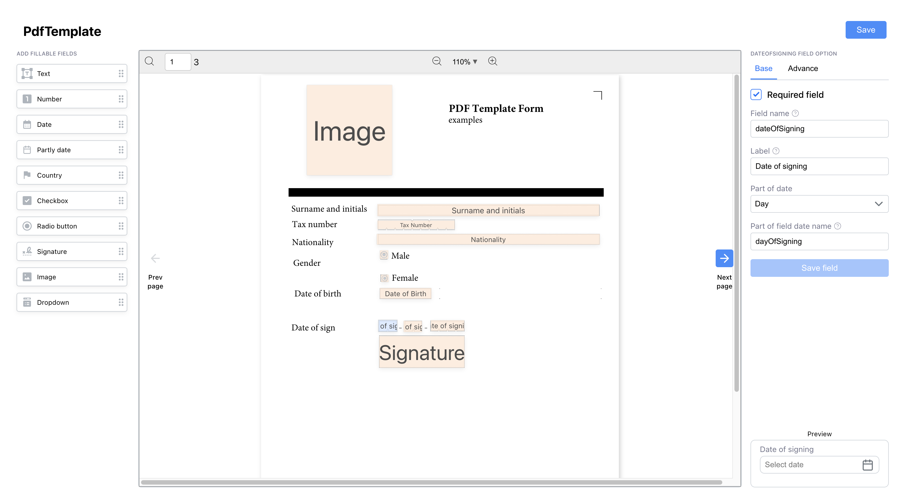
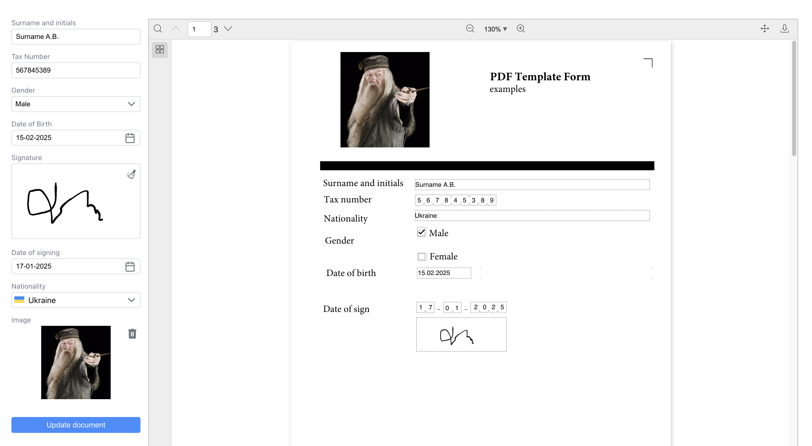

# react-pdf-build-filler

## Description

**react-pdf-build-filler** is a library for working with PDFs in React. It allows you to create, edit, and fill PDF documents directly in the browser. The main idea of the library is to create PDF forms and fields for further filling and editing. At the same time, a form is automatically generated in your project for filling in these fields.

## Installation

Install the library via npm or yarn:

```sh
# npm
npm install react-pdf-build-filler

# or yarn
yarn add react-pdf-build-filler
```

## Usage

## PdfConstructor



### Example 1: Basic Usage of PdfConstructor

```tsx
import React from "react";
import { PdfConstructor } from "react-pdf-build-filler";

// styles
import "react-pdf-build-filler/react-pdf-build-filler.css";

const MyComponent = ({ file }) => {
  return (
    <PdfConstructor
      data={{
        pdfFile: file,
      }}
      onUpdateField={() => console.log("Field was updated successfully!")} // add some success notification
      onSave={(data) => console.log("Pdf saved successfully", data)}
    />
  );
};

export default MyComponent;
```

### Example 2: Using `fields` (Updating Existing Fields)

If `fields` is provided, it updates existing settings.

```tsx
import React from "react";
import { PdfConstructor } from "react-pdf-build-filler";

// styles
import "react-pdf-build-filler/react-pdf-build-filler.css";

const MyComponent = ({ file, fieldsFromPreviousTemplate }) => {
  return (
    <PdfConstructor
      data={{
        pdfFile: file,
        templateName: "Template Pdf 1",
        fields: [...fieldsFromPreviousTemplate], // get from first example (onSave = (data) => data.templateData)
      }}
      onUpdateField={() => console.log("Field was updated successfully!")} // add some success notification
      onSave={(data) => console.log("Pdf saved successfully", data)}
    />
  );
};

export default MyComponent;
```

### Example 3: Adding `classes` for Styling

```tsx
import React from "react";
import { PdfConstructor } from "react-pdf-build-filler";

// styles
import "react-pdf-build-filler/react-pdf-build-filler.css";

const MyComponent = ({ file, classes }) => {
  return (
    <PdfConstructor
      data={{
        pdfFile: file,
        templateName: "Styled Template",
      }}
      classes={{
          formBuilder: {
            header: "Form_Builder_class",
            title: "Title_class",
            button: "Button_class",
          },
          pdfViewerZone: {
            prevPage: "Prev_Page_class",
            nextPage: "Next_Page_class",
            pageButton: "Page_Button_class",
          },
          settings: {
            tabs: {...classes.tabs}
          },
      }}
      onUpdateField={() => console.log("Field was updated successfully!")} // add some success notification
      onSave={(data) => console.log("Pdf saved successfully", data)}
    />
  );
};

export default MyComponent;
```

### Example 4: Using `customComponents`

```tsx
import React from "react";
import { PdfConstructor } from "react-pdf-build-filler";
import CustomInput from "./CustomInput";
import CustomCheckbox from "./CustomCheckbox";
import CustomSelect from "./CustomSelect";

// styles
import "react-pdf-build-filler/react-pdf-build-filler.css";

const MyComponent = ({ file }) => {
  return (
    <PdfConstructor
      data={{
        pdfFile: file,
      }}
      customComponents={{
        input: CustomInput,
        checkbox: CustomCheckbox,
        select: CustomSelect,
      }}
      onUpdateField={() => console.log("Field was updated successfully!")} // add some success notification
      onSave={(data) => console.log("Pdf saved successfully", data)}
    />
  );
};

export default MyComponent;
```

## PdfConstructor Props

| Prop              | Type                         | Description                         |
| ----------------- | --------------------------- | ----------------------------------- |
| `data`           | `IDataConstructor`          | Data for the form                   |
| `classes`        | `IPdfConstructorClasses`    | Styles for components               |
| `onSave`        | `(result: IResult) => void` | Function to save the modified PDF   |
| `customComponents` | `TCustomComponents`         | Custom components                   |
| `onUpdateField`  | `() => void`       | Function to update fields           |

### Data Format

```ts
interface IDataConstructor {
  pdfFile: File;
  templateName?: string;
  fields?: IBuilderField[];
}

interface IBuilderField {
  formData: Record<string, ICustomFieldByRole[]>;
  templateData: IBuilderField[];
  file: File;
}
```

---

## PdfReader Component

### Description

The `PdfReader` component allows users to fill and interact with pre-defined PDF forms in the browser. It takes a PDF file, loads predefined fields, and enables filling them in before submission. This component is useful for rendering an interactive PDF form where users can fill in values and submit the completed document.




### Props

| Prop               | Type                                      | Description                         |
| ------------------ | ---------------------------------------- | ----------------------------------- |
| `pdfFile`         | `File`                                   | The PDF file to be displayed       |
| `isDisabled`      | `boolean` (optional)                     | Disables all fields (readOnly)             |
| `classes`         | `PdfReaderClasses` (optional)            | Styles for components              |
| `customComponents`| `TCustomComponents` (optional)           | Custom components            |
| `initialValues`   | `IDefaultValuesDynamicForm` (optional)   | Initial form values (autofilling)               |
| `formData`        | `Record<string, ICustomFieldByRole[]>`   | Predefined form fields             |
| `onConfirm`       | `(result: IPdfReaderResult) => void`     | Callback function for form submission |

### Example Usage

```tsx
import React from "react";
import { PdfReader } from "react-pdf-build-filler";

// styles
import "react-pdf-build-filler/react-pdf-build-filler.css";

const MyComponent = ({ file, formData }) => {
  return (
    <PdfReader
      pdfFile={file}
      formData={formData}
      onConfirm={(result) => console.log("Form submitted", result)}
    />
  );
};

export default MyComponent;
```

### Example 2: Using `initialValues`
```tsx
import React from "react";
import { PdfReader } from "react-pdf-build-filler";

// styles
import "react-pdf-build-filler/react-pdf-build-filler.css";

const MyComponent = ({ file, formData, initialValues }) => {
  return (
    <PdfReader
      pdfFile={file}
      formData={formData}
      initialValues={{
        surname: "MySurname",
        firstName: "MyFirstName",
        gender: "Male",
        ...initialValues
      }}
      onConfirm={(result) => console.log("Form submitted", result)}
    />
  );
};

export default MyComponent;
```
# Using Styled Components with `react-pdf-build-filler`

If your project utilizes `styled-components` in development, you can easily update certain styles by importing specific class constants provided by the library. Below are examples for both `PdfConstructor` and `PdfReader` components.

## For `PdfConstructor`:
```tsx
import { PDFConstructorClasses } from "react-pdf-build-filler";

export const YourComponent = styled.div`
  ${PDFConstructorClasses.formBuilder.header} {
    /* Your custom styles here */
  }

  ${PDFConstructorClasses.formBuilder.button} {
    /* Your custom styles here */
  }
`;
```

## For `PdfReader`:
```tsx
import { PDFReaderClasses } from "react-pdf-build-filler";

export const YourComponent = styled.div`
  ${PDFReaderClasses.content} {
    /* Your custom styles here */
  }

  ${PDFReaderClasses.components.input.label} {
    /* Your custom styles here */
  }
`;
```


